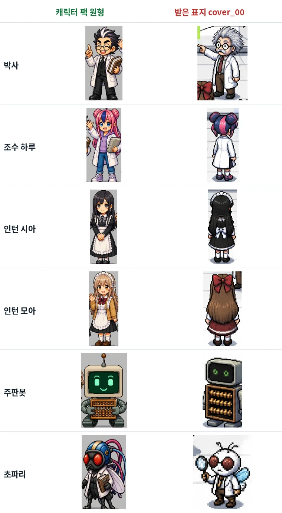

# 캐릭터 원형 평가 — 받은 표지 26장 (2026-11-26)

> 기준: 캐릭터 팩 [fruitfly-lab-expressions](https://github.com/adminmrobo/fruitfly-lab-expressions)의 `specs/*/00_character_core.md` 「아이덴티티 고정값 — 변경 금지」와 단체 그림 `images/_sheets/lab6_lineup.png`. 비교 그림: `docs/img/character_check.webp` (왼쪽 원형, 오른쪽 cover_00).



## 1. 캐릭터별 판정

| 캐릭터 | 원형의 변경 금지 포인트 | 받은 표지 | 판정 |
|---|---|---|---|
| 박사 | 숯색 뾰족 머리 + 앞머리 흰 줄, 작은 꽁지머리, 아주 굵은 검은 눈썹, 청록 사각 안경, 흰 가운 + 검은 조끼·넥타이 | 회색 산발 머리, 콧수염, 둥근 안경, 갈색 바지 | **원형 상실 (심각)** — 다른 인물로 보임 |
| 조수 하루 | 분홍 생머리 + 남색 줄, 번 2개, 파란 눈, 라벤더 후드티 + 흰 가운, 청바지 | 분홍·남색 번 머리와 흰 가운은 맞음, 후드티·청바지 없음 | **부분 일치 (보통)** |
| 인턴 시아 | 흑발, **머리 장식 없음**, 차콜 메이드 원피스, 회색 리본, 흰 앞치마 | 흑발은 맞지만 흰 프릴 머리 장식이 있음 | **금지 사항 위반 (보통)** — 모아와 구별 포인트가 사라짐 |
| 인턴 모아 | 애쉬 베이지 머리 + 흰 프릴 머리띠, 카멜 카디건, 빨강·남색 체크 리본, 흰 앞치마 | 갈색 머리, 큰 빨간 리본, 빨간 치마 | **원형 상실 (심각)** |
| 주판봇 | **베이지 CRT 모니터** 몸체 + 짙은 초록 화면, 안테나 끝 주판알, 회색 팔, 무한궤도, 손에 든 작은 나무 주판 | 회색 상자 몸체, 주판이 몸통 앞면에 붙음, 다리 받침 | **원형과 다름 (심각)** |
| 초파리 연구원 | **숯빛 검은 몸통**, 빨간 겹눈, **남색 레트로 헬멧** + 노랑·흰 줄, 자홍·보라·파랑 케이블 | **흰 몸통**, 헬멧·케이블 없음 | **원형 상실 (심각)** — 지적하신 그대로 |
| 미공개 X1~X3 | 검은 실루엣, 눈만 보임 | 검은 실루엣 | 일치 |

26장 모두 같은 프롬프트 묶음에서 나와서, 위 차이가 전 장에 걸쳐 되풀이돼요(11장 시아·모아 실루엣 오용, 22장 노을·23장 하늘 배경 포함).

## 2. 원인 — 프롬프트를 쓴 제 책임이 가장 커요

1. **캐릭터 묘사를 캐릭터 팩 명세가 아니라 추측으로 썼어요.** 「wild grey hair, round glasses」(박사), 「long light-brown hair, red bow」(모아), 「boxy abacus robot」(주판봇), 「tiny fly in a lab coat」(초파리) — 그림 도구는 이 문장을 그대로 따랐어요.
2. **레퍼런스 안내가 약했어요.** 「함께 올릴 것」에 4명만 적었고 시아·모아와 단체 그림(lab6_lineup)을 빠뜨렸어요. 「원형을 바꾸지 말라」는 금지 문장(네거티브)도 없었어요.
3. **작은 인물의 단순화.** 장면 그림에서 캐릭터가 작아지면 그림 도구가 세부를 일반적인 모습(흰 벌레, 회색 로봇)으로 바꾸는 경향이 있어요.

## 3. 결정 (채택안)

1. **표지 31장(기존 26 + 활용 편 5)을 다시 그린다.** 새 프롬프트는 캐릭터 팩의 `CHARACTER_CORE_EN` 문장을 그대로 옮기고, 캐릭터마다 「NOT …」 금지 문장과 공통 네거티브를 붙였어요 → `docs/IMG_prompts_batches.md`.
2. **레퍼런스는 반드시 함께:** `lab6_lineup.png`(여섯 식구 단체) + 장에 나오는 캐릭터의 E13 얼굴. cover_00을 먼저 받아 아래 점검표를 통과한 뒤 그 그림을 2차 레퍼런스로 나머지를 요청.
3. **새 그림이 오기 전까지는 원형과 다른 표지를 내리고 대체 표지(캐릭터 팩 원형 얼굴 + 픽셀 배경)로 보여 준다.** 받은 26장은 지우지 않고 `img/cover_offmodel/`에 보관했어요. 되돌리려면 파일을 `img/cover/`로 옮기고 다시 빌드하면 돼요.
4. **4컷 애니와 본문 캐릭터는 캐릭터 팩 그림만 쓴다.** 그래서 원형이 깨질 일이 없어요.
5. **원형 점검표를 그림 반영의 통과 조건으로 쓴다** (페르소나 검사에 「캐릭터 원형」 항목 추가).

## 4. 원형 점검표 (그림을 받을 때 하나라도 ✗이면 다시 요청)

| 캐릭터 | 확인 1 | 확인 2 | 확인 3 |
|---|---|---|---|
| 박사 | 숯색 뾰족 머리 + 앞머리 흰 줄 | 굵은 검은 눈썹 · 청록 사각 안경 | 흰 가운 + 검은 조끼·넥타이 (콧수염 없음) |
| 하루 | 분홍 + 남색 줄 머리, 번 2개 | 라벤더 후드티 + 흰 가운 | 파란 눈, 청바지 |
| 시아 | 흑발, 머리 장식 없음 | 차콜 메이드 원피스 + 회색 리본 | 흰 앞치마 |
| 모아 | 애쉬 베이지 머리 + 흰 프릴 머리띠 | 카멜 카디건 + 체크 리본 | 흰 앞치마, 검은 치마 |
| 주판봇 | 베이지 CRT 모니터 몸체 | 짙은 초록 화면 + 민트 눈 | 무한궤도, 손에 작은 주판 |
| 초파리 | 검은 몸통 | 남색 헬멧 + 빨간 겹눈 | 자홍·보라·파랑 케이블 |

## 5. 새 표정 요청 — 시아·모아 「머리 감싸기」(E27)

이론 구간에서 시아·모아가 「머리를 붙잡고 괴로워하는」 장면은 지금 캐릭터 팩에 없는 동작이에요. 받기 전까지는 팩의 **E21 폭포 눈물·E24 충격 + 「지끈」 흔들림 효과**로 대신해요. 요청문(팩의 E25·E26 확장 표정과 같은 형식):

```
[reference: sia E13_neutral.png, sia E24_shock.png]
Sia, a calm anime girl maid intern in a research lab, long straight jet-black hair reaching the waist with side-swept bangs and two thin strands framing the face, calm gray eyes, small silver drop earrings, long-sleeved charcoal-black maid dress with puffed shoulders and white lace cuffs, white high collar with a large soft gray bow, long white frilled apron, no headdress, no glasses.
Expression E27 head_clutch: both hands pressed on both sides of her head, eyes squeezed shut in a pained swirl, small wavy mouth, two tiny sweat drops, three short comic stress lines above the head.
bust-up portrait from chest up, facing viewer, centered, same framing as the reference expression sheet. detailed 16-bit SNES-era pixel art, limited palette, crisp pixels, dithering shading, thick dark outlines, cheerful comedy mood, no readable text, no letters, no words. plain flat light gray background.
Negative: blurry, smooth vector art, 3D render, photorealistic, off-model, headdress, maid headband, glasses, colored hair, text, watermark, multiple characters.
```

```
[reference: moa E13_neutral.png, moa E24_shock.png]
Moa, a gentle cheerful anime girl maid intern in a research lab, long ash-beige hair reaching the waist with soft wavy ends and neat bangs, white frilled maid headband with a thin white ribbon over the left ear, big round amber-brown eyes, white shirt with a red and navy plaid bow tie, camel knit cardigan with ribbed cuffs, white frilled apron with ruffled shoulder straps, no glasses.
Expression E27 head_clutch: both hands gripping the top of her head, teary spiral eyes, open wobbly mouth, comic steam puff above the head, two tiny sweat drops.
bust-up portrait from chest up, facing viewer, centered, same framing as the reference expression sheet. detailed 16-bit SNES-era pixel art, limited palette, crisp pixels, dithering shading, thick dark outlines, cheerful comedy mood, no readable text, no letters, no words. plain flat light gray background.
Negative: blurry, smooth vector art, 3D render, photorealistic, off-model, black hair, pink hair, ponytail, missing headband, glasses, text, watermark, multiple characters.
```

받으면 `sia/E27_head_clutch.png`, `moa/E27_head_clutch.png`로 캐릭터 팩에 넣고 `python3 tools/add_sprites.py <팩 폴더>`(WANT 목록에 E27 추가)로 반영해요.

---

## 다시 받은 그림 점검 (2026-11-26)

원형 지키기 지시문으로 다시 받은 표지 31장과 E27 표정 2장을 점검했어요.

| 항목 | 결과 |
|---|---|
| 초파리 | 통과 — 검은 몸, 빨간 겹눈, 남색 헬멧, 케이블 (31장 모두) |
| 박사 | 통과 — 짙은 회흑색 뾰족 머리 + 앞머리 흰 줄, 청록 안경, 콧수염 없음 |
| 주판봇 | 통과 — 베이지 브라운관 몸, 초록 화면 얼굴, 무한궤도, 손에 주판 |
| 하루 · 시아 · 모아 | 통과 — 시아 머리 장식 없음, 모아 재색 베이지 머리 + 프릴 머리띠 |
| 픽셀 격자 | 31장 모두 480×270 격자의 정확한 4배 → 받은 파일 그대로 반영 |
| 사소한 점 | cover_10에 흰 가운 차림 인물이 하나 더 그려져 박사가 둘처럼 보임. 다음에 다시 그릴 때 고칠 후보로 남겨요 |
| E27 시아 | 통과 — 두 손으로 머리를 감싸고 눈이 소용돌이. 이론 접기 상자와 4컷 첫 장면에 반영 |
| E27 모아 | 불통과 — 웃는 전신 그림, 검은 배경, 손이 머리에 없음. `docs/img/e27_moa_rejected.webp`에 보관하고 지시문을 고쳐 다시 요청 |
